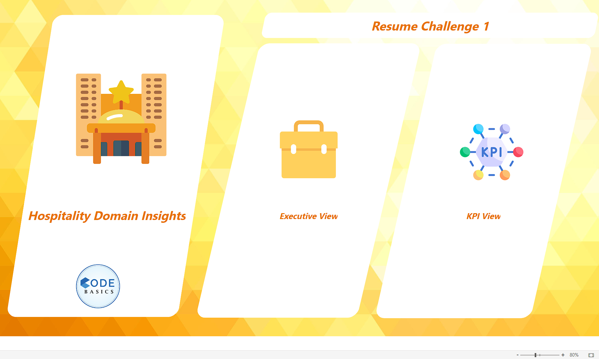
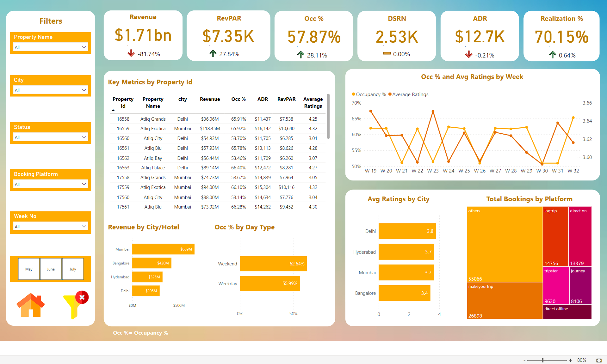
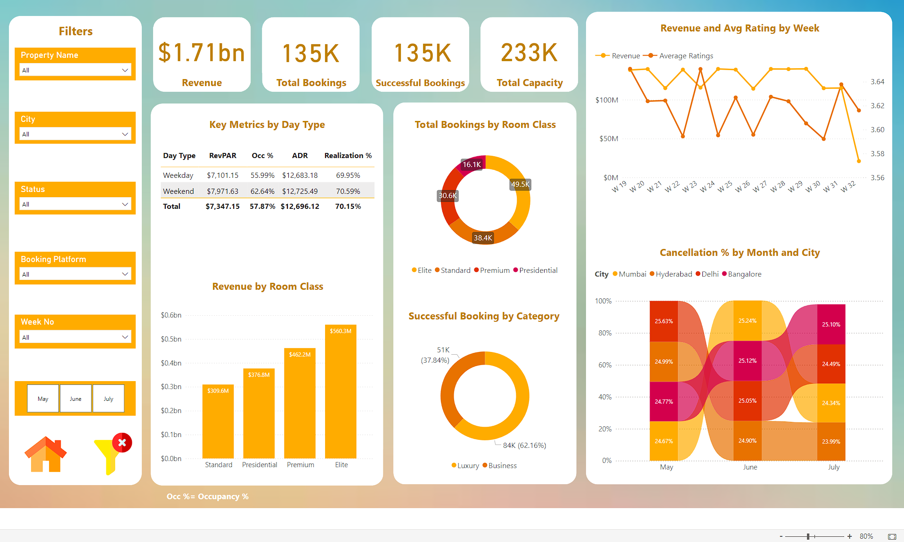
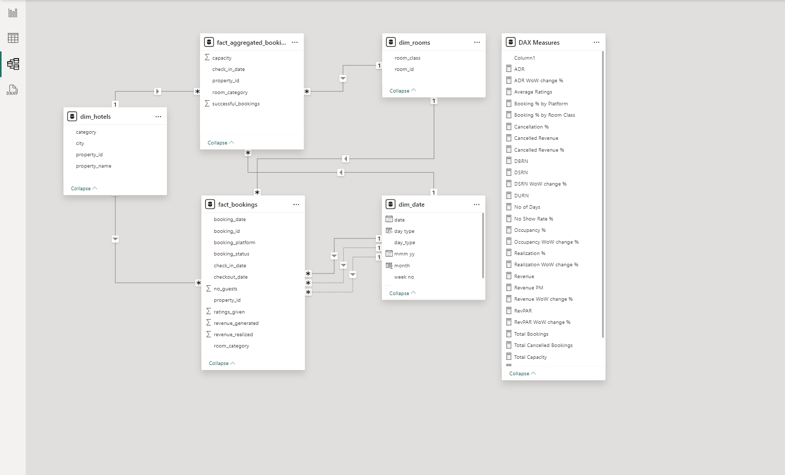

# Hospitality Revenue & Market Share Analytics

**An end-to-end Business Intelligence project built entirely in Microsoft Power BI.**

This project explores hotel revenue performance, occupancy, realization, RevPAR, customer ratings, and booking-channel trends across AtliQ Hotels. It turns three months of booking data into an interactive Power BI report and actionable business recommendations.

---

## Dashboard Preview

| Home Page | Executive View |
|---|---|
|  |  |

### KPI View

### Data Model

---

## Project at a Glance

| Area | Details |
|---|---|
| Business domain | Hospitality |
| Business | AtliQ Hotels |
| Project type | Business Intelligence & Revenue Analytics |
| BI platform | Microsoft Power BI Desktop |
| Data preparation | Power Query Editor |
| Data modelling | Power BI Model View |
| Calculations | DAX |
| Reporting | Power BI Report View |
| Data sources | 5 CSV files |
| Analysis period | May–July 2022 |
| Markets | Mumbai, Bangalore, Hyderabad, Delhi |

## Business Problem

AtliQ Hotels needed to understand where its business was underperforming and what actions could improve revenue performance and market position.

The analysis focuses on identifying performance gaps, understanding revenue and occupancy trends, evaluating property performance, and finding opportunities to strengthen the hotel portfolio.

## Business Objective

Analyze revenue, occupancy, realization, RevPAR, and customer ratings across properties, cities, booking platforms, and time periods; identify performance gaps; and provide data-driven insights to support revenue optimization and market-share improvement.

## Tools & Development Workflow

The project was developed end-to-end in Power BI Desktop:

1. **Data ingestion** — imported the source CSV files into Power BI.
2. **Data extraction and transformation** — prepared the source tables in Power Query Editor.
3. **Data modelling** — organized the dimension and fact tables and established model relationships in Model View.
4. **DAX analysis** — created measures to evaluate the hospitality KPIs.
5. **Report development** — built the report pages and interactive visuals in Report View.

## Dataset

The repository contains five source tables:

| Table | Purpose |
|---|---|
| `dim_date` | Date, month, week number, and day type |
| `dim_hotels` | Property name, category, and city |
| `dim_rooms` | Room category and room class |
| `fact_aggregated_bookings` | Successful bookings and room capacity by property, date, and room category |
| `fact_bookings` | Booking details, platform, status, ratings, and generated/realized revenue |

See [Data & Source Files](data/README.md) for more information and [Project Documentation](documentation/README.md) for the data dictionary and reference materials.

## Dashboard Pages

### Home Page
The report landing page provides navigation into the analysis.

### Executive View
Presents the portfolio-level KPI summary, including revenue, RevPAR, occupancy, DSRN, ADR, and realization. Supporting visuals include property-level performance, weekly occupancy and average-rating trends, revenue by city/hotel, occupancy by day type, average ratings by city, and booking-platform mix.

### KPI View
Presents revenue, total bookings, successful bookings, and total capacity. Supporting visuals analyze RevPAR, occupancy, ADR, and realization by day type; bookings by room class; revenue by room class; successful bookings by property category (Luxury and Business); weekly revenue and average-rating trends; and cancellation percentage by month and city.

Explore the [dashboard files and screenshots](dashboard/README.md).

## Key Findings

The following are the key results from the project analysis:

### Property performance
- **AtliQ Exotica** generated the highest property revenue (**$320M**) and recorded the highest RevPAR (**7.82K**).
- **AtliQ Seasons** recorded the lowest revenue (**$70M**).
- **AtliQ Blu** achieved the highest occupancy (**62.02%**).
- AtliQ Exotica recorded the highest realization rate (**71.18%**), while AtliQ Grands had the lowest (**69.94%**).

### Booking-platform performance
- **MakeYourTrip** generated the highest booking-platform revenue (**$340M**).

### Geographical performance
- **Mumbai** recorded the highest city revenue (**$670M**), followed by Bangalore, Hyderabad, and Delhi.

### Weekly trends
- **Week 29** recorded the highest weekly revenue at approximately **$139.73M**.
- **Week 23** recorded the highest average rating (**3.66**).

## Business Insights

1. **Property performance differs across the portfolio.** AtliQ Exotica leads in revenue and RevPAR, while AtliQ Seasons records the lowest revenue. Improvement plans should be tailored to individual properties.
2. **Occupancy and revenue leadership are not concentrated in the same property.** AtliQ Blu leads occupancy, whereas AtliQ Exotica leads revenue and RevPAR. Occupancy should be reviewed alongside realization and revenue metrics.
3. **Mumbai is the strongest revenue market in the analysis.** Its performance offers a useful starting point for investigating practices that may be relevant to other cities.
4. **Realization varies by property.** The gap between the highest and lowest realization rates warrants further investigation into pricing, booking mix, discounts, and cancellations.

## Business Recommendations

1. Develop a property-level turnaround plan for **AtliQ Seasons**.
2. Study the performance drivers behind **AtliQ Exotica's** revenue and RevPAR and **AtliQ Blu's** occupancy.
3. Prioritize growth opportunities in weaker city markets, using Mumbai as a benchmark for further investigation.
4. Introduce weekly monitoring of revenue, occupancy, realization, and customer ratings.
5. Review booking-channel contribution and optimize the channel strategy, including the role of **MakeYourTrip**.

## Repository Guide

| Folder / File | Contents |
|---|---|
| [`data/`](data/README.md) | Five raw CSV source tables |
| [`dashboard/`](dashboard/README.md) | Power BI report and page screenshots |
| [`documentation/`](documentation/README.md) | Data dictionary, data model, metrics reference, and dashboard mock-up |
| [`assets/`](assets/) | Project thumbnail and visual assets |
| `README.md` | Project overview and navigation |

## How to Explore

1. Clone or download this repository.
2. Open `dashboard/AtliQ-Hotels-Revenue-Analytics.pbix` in Power BI Desktop.
3. Explore the Home Page, Executive View, and KPI View.
4. Refer to the CSVs in `data/` and supporting material in `documentation/`.

**Data-source note:** The PBIX may retain the CSV file locations used when the report was originally created. Since the source files are now stored in `data/` and the PBIX is stored in `dashboard/`, check the source steps in Power Query and update the paths to the corresponding files in `data/` if Power BI cannot locate them when refreshing.

## Project Credits

Developed by **[Aryan Pokhriyal](https://www.linkedin.com/in/aryanpokhriyal/)** as part of **Codebasics Resume Project Challenge 1 — Hospitality Domain: Provide Insights to the Revenue Team**.

**LinkedIn Post: [Click here ↗](https://lnkd.in/p/geaw-2Mj)**

**Presentation Video: [Watch on YouTube ↗](https://youtu.be/8yAW8uQmNX4?si=Yg0UsqXlhB_ofcSq)**
