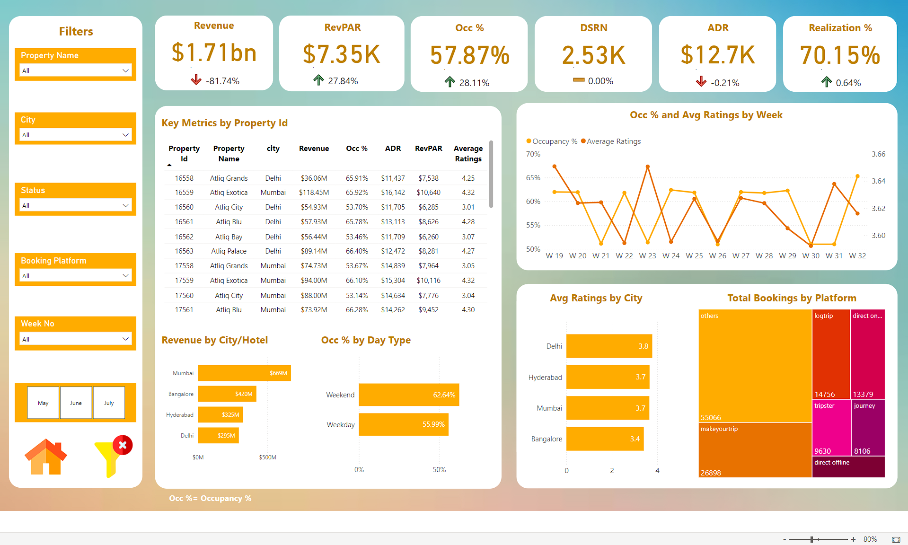
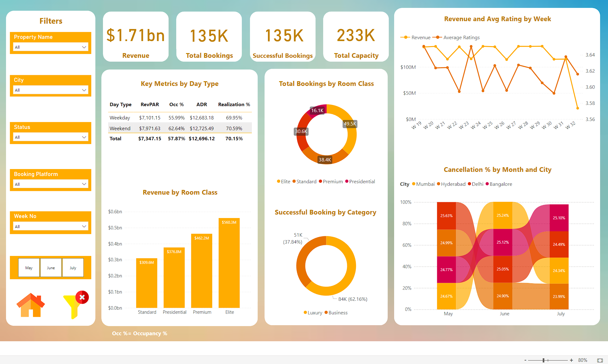

# Power BI Dashboard

This folder contains the Power BI report file and the report-page screenshots.

## Power BI report

- [AtliQ Hotels Revenue Analytics (.pbix)](AtliQ-Hotels-Revenue-Analytics.pbix)

Open the PBIX file in **Power BI Desktop** to interact with the report.

## Report screenshots

| Page | Preview |
|---|---|
| Home Page |  |
| Executive View |  |
| KPI View |  |

## Refreshing the report

The report was developed using the CSV source files in the project. If Power BI cannot locate the source files on another machine, open **Transform data → Data source settings** or review the source steps in Power Query and point them to the local `data/` folder, then refresh.

